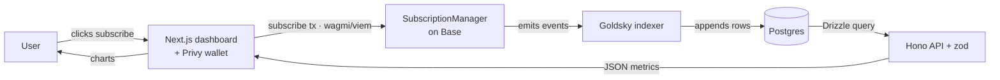

# onchain-stripe

**Stripe, on-chain.** Recurring **USDC subscriptions on Base** — a non-custodial payment contract plus the full off-chain stack that turns its events into a live revenue dashboard (MRR, active subscribers, churn).

The contract is deliberately tiny; the *data* is rich. That split is the point: money routing stays on-chain and verifiable, while everything a creator actually wants to look at is derived off-chain from the event log.

> **Live on Base Sepolia** — [`0xc91a4d1B95Ea603f01125b9590baF130613a3665`](https://sepolia.basescan.org/address/0xc91a4d1B95Ea603f01125b9590baF130613a3665) · fee 2.5% · merchant registration 10 USDC
> USDC is an open-mint [mock](https://sepolia.basescan.org/address/0x93b34C315d4F0F91F0d3702474fa3AB211f0640C) (`0x93b3…640c`), so you can fund yourself and run the whole flow end to end.

---

## Architecture — one data-flow loop

Every arrow follows **data**, never a request. The two halves never call each other — Postgres is the meeting point. The chain is the source of truth; the DB is a fast, queryable mirror.



- **Write half:** user → dashboard → contract → indexer → Postgres
- **Read half:** Postgres → API → dashboard → user

| Layer | Tool |
| --- | --- |
| Contract | Foundry / Solidity 0.8.30 / Solady, on Base |
| Indexing | Goldsky (chain events → Postgres) |
| Database | Postgres (Neon) + Drizzle |
| API | Hono + zod |
| Frontend | Next.js 16 · wagmi · viem · TanStack Query |
| Wallet / auth | Privy (embedded wallet + JWT-verified API auth) |
| Email | Resend, driven by a cron-hit endpoint |

---

## Repo layout

```
contracts/          Foundry project — SubscriptionManager.sol, tests, deploy scripts
api/                Hono API + Drizzle schema/migrations/views (Postgres)
frontend/           Next.js dashboard (merchant + subscriber views)
docs/               architecture diagram
.github/workflows/  CI — forge fmt / build / test
```

pnpm workspace: `api` and `frontend` are packages; `contracts` is a standalone Foundry project.

---

## The contract

`SubscriptionManager.sol` is a **payment router + bookkeeper, never a vault**. Every token that comes in leaves in the same transaction. Nothing is retained, so the audit surface collapses to two questions: *does money route correctly*, and *can the bookkeeping be faked*.

### Three actors

| Stripe | Here | Can |
| --- | --- | --- |
| Business | `merchant` | pay a fee to register, then create/update/disable plans |
| Customer | `user` | subscribe, renew, cancel |
| Stripe | `protocol` (owner) | set the fee rate, fee recipient, merchant registration fee |

### Core functions

```solidity
registerMerchant()                       // pays merchantFee → feeRecipient, unlocks createPlan
createPlan(name, price, interval)        // merchant-gated
subscribe(planId, periods)               // expiry = now + periods × interval
renew(subId, periods)                    // expiry = max(oldExpiry, now) + periods × interval
cancel(subId)                            // stops future renewals
```

Each payment splits in one tx:

```
fee    = amount × feeRate / 10_000        (feeRate capped at 10%)
user → merchant      : amount − fee
user → feeRecipient  : fee
```

### Design decisions worth naming

- **Deterministic `subId` = `keccak256(subscriber, planId)`** — no counter, so duplicate subscriptions are impossible by construction. `subscribe` is create-once (reverts `SubscriptionExists` on any existing slot); `renew` is what revives a cancelled or lapsed one.
- **`active` is stored on plans only.** A subscription's active-ness is *derived* (`!cancelled && expiresAt > now`), never stored — a lapse fires no transaction, so a stored bool would silently go stale. `expiresAt` can't.
- **Renew is correct early *and* late:** `max(oldExpiry, now) + interval` — renewing after a lapse never grants a period that's already gone.
- **Disable, don't delete.** An inactive plan blocks new subscribes *and* renewals; existing subscriptions are honored to expiry, then lapse.
- **Plan edits are forward-only** — changing price/interval never touches time already paid for.
- **Per-row authorization** — only `plans[id].merchant` can edit its own plan; only `owner` touches protocol knobs.
- **No `Lapsed` event.** A lapse is a non-event — no transaction happens. Churn is derived off-chain by comparing `expiresAt` to `now()`.
- **`indexed` = filter keys only** (`subscriber`, `subId`, `planId`, `merchant`) — never values or strings, since an indexed string hashes into something unreadable.
- **CEI everywhere.** USDC has no transfer callback, so reentrancy isn't a live threat here — state is still written before the transfers.

### Events (the contract between every layer)

```solidity
event MerchantAdded (address indexed merchant, uint256 merchantFee);
event PlanCreated   (address indexed merchant, uint256 indexed planId, string name, uint256 price, uint256 interval);
event PlanUpdated   (address indexed merchant, uint256 indexed planId, uint256 price, uint256 interval);
event PlanStatusChanged(address indexed merchant, uint256 indexed planId, bool active);
event Subscribed    (address indexed subscriber, bytes32 indexed subId, uint256 indexed planId, uint256 amount, uint256 expiresAt);
event Renewed       (address indexed subscriber, bytes32 indexed subId, uint256 indexed planId, uint256 amount, uint256 expiresAt);
event Cancelled     (address indexed subscriber, bytes32 indexed subId, uint256 indexed planId);
event FeeRateSet(uint256 newFeeRate);
event MerchantFeeSet(uint256 newMerchantFee);
event FeeRecipientSet(address indexed newRecipient);
```

No `timestamp` field — the block already carries it.

---

## Data layer — append-only log, derived views (CQRS)

Goldsky writes to exactly **one** table: `events`, append-only, one row per emitted event, keyed `id = tx_hash:log_index` so a replay can never double-count.

Current state is never stored. It's folded out of the log by Postgres **views** at read time:

- **`v_subscriptions`** — `DISTINCT ON (sub_id) ORDER BY block DESC`: latest `Subscribed`/`Renewed` gives `expires_at`; "is the newest event a `Cancelled`?" gives `cancelled`.
- **`v_plans`** — `PlanCreated` supplies name/merchant, the latest create-or-update supplies price/interval, the latest `PlanStatusChanged` supplies `active` (`COALESCE(…, true)`).

Two small tables hold state the chain doesn't own: `subscriber_emails` (address → email + confirmation token) and `expiry_notices` (`PRIMARY KEY (sub_id, expires_at)` — the idempotency guard that stops the cron from emailing the same person twice about the same period).

**Money is cast to `bigint` (raw 6-decimal base units), never `numeric`,** in the Goldsky transform — a `numeric` cast there silently multiplies by 10¹⁰.

---

## API

Hono + zod, all reads validated at the boundary. Base path `/api/v1`.

| Method | Route | Auth | Returns |
| --- | --- | --- | --- |
| `GET` | `/metrics?merchant=0x…` | — | `{ mrr, active, churn }` |
| `GET` | `/v_plans` | — | all plans |
| `GET` | `/v_subscriptions?subscriber=0x…` | — | that address's subscriptions |
| `POST` | `/settings/email` | Privy JWT | stores email, sends a confirmation link |
| `GET` | `/settings/email` | Privy JWT | `{ email, confirmed }` or `null` |
| `GET` | `/settings/confirm?token=…` | one-time token | confirms the address |
| `POST` | `/cron/expiry` | `x-cron-secret` | emails subs expiring within 3 days |

**Metrics are computed in SQL, not JavaScript** — compute close to the data, display far from it:

- **MRR** is a *snapshot*, not a lifetime sum: `Σ price over every subscription active right now`. A cancellation drops a row from the set; it never subtracts from a running total.
- **Active** = `expires_at > now() AND NOT cancelled`.
- **Churn** = the exact complement.

All three come from one pass using `FILTER (WHERE …)` per aggregate, and all three use the **database's** `now()` — so every number on the dashboard shares one notion of "current".

Auth: the wallet address is read from the verified Privy JWT, never from the request body.

---

## Frontend

Next.js App Router. One page, two roles — it renders the merchant tools (create/update/disable plans, revenue metrics) only when `isMerchant(address)` returns true, and the subscriber view (browse plans, subscribe, renew, cancel, notification settings) for everyone.

- **Privy** for login + embedded wallet, so a subscriber never needs an extension.
- **wagmi + viem** for writes; each contract function maps 1:1 to a hook that disables its button while pending, surfaces the revert as a toast, and invalidates the affected read on success.
- **TanStack Query** polls the API every 30s — a revenue dashboard isn't a trading screen, but >1 min feels stale right after you act.
- A boot gate holds one loading screen until plans, metrics and subscriptions have all landed, instead of letting the page assemble piecemeal.

---

## Running it locally

**Prerequisites:** [Foundry](https://book.getfoundry.sh/getting-started/installation), Node 20+, pnpm, a Postgres database (Neon's free tier works), and accounts on [Privy](https://privy.io) + [Resend](https://resend.com) if you want auth and emails.

```bash
git clone --recurse-submodules https://github.com/tymna/onchain-stripe
cd onchain-stripe
pnpm install
```

### 1. Contracts

```bash
cd contracts
cp .env.example .env          # RPC URL, Etherscan key, cast keystore account
make build test               # forge build / forge test
make deploy-base-sepolia      # broadcast + verify
make mint approve             # fund yourself with mock USDC, approve the manager
```

On Base Sepolia the deploy script also deploys an open-mint `MockUSDC` (the real faucet is dry). Put the resulting `MANAGER` and `MOCK_USDC` addresses back into `.env` before `make mint`.

### 2. Database + indexer

```bash
cd api
cp .env.example .env                        # DATABASE_URL and friends
pnpm drizzle-kit migrate                    # events, subscriber_emails, expiry_notices
psql "$DATABASE_URL" -f drizzle/views.sql   # v_plans, v_subscriptions
```

Migrations create the tables; `views.sql` creates the two read-side views (Drizzle only declares them as `.existing()`, it never creates them).

Then point a Goldsky pipeline at the deployed contract: the contract ABI, `start_at` = the deploy block, sinking every event into the `events` table with money cast as `bigint`.

### 3. API

```bash
pnpm api                      # from the repo root → http://localhost:3001
```

### 4. Frontend

```bash
cp frontend/.env.example frontend/.env
pnpm web                      # from the repo root → http://localhost:3000
```

### 5. Expiry emails (optional)

Point any scheduler (cron-job.org, a GitHub Action, `crontab`) at the endpoint once a day:

```bash
curl -X POST $API_URL/api/v1/cron/expiry -H "x-cron-secret: $CRON_SECRET"
```

### Environment variables

| Package | Variable | What it is |
| --- | --- | --- |
| `contracts` | `BASE_SEPOLIA_RPC_URL` | Alchemy or public Base Sepolia RPC |
| | `ETHERSCAN_API_KEY` | Etherscan v2 key (verifies across Base + Ethereum) |
| | `ACCOUNT` / `SENDER` | `cast` keystore account name **and** its address — both are required, or `owner` deploys wrong |
| | `MANAGER` / `MOCK_USDC` | filled in after deploying; used by `make mint` / `make approve` |
| `api` | `DATABASE_URL` | Postgres connection string |
| | `PORT` | defaults to 3001 |
| | `FRONTEND_URL` | CORS origin |
| | `API_URL` | the API's own public address — where confirmation links point |
| | `PRIVY_APP_ID` / `PRIVY_APP_SECRET` | server-side token verification |
| | `RESEND_API_KEY` | transactional email |
| | `CRON_SECRET` | shared secret for `/cron/expiry` |
| `frontend` | `NEXT_PUBLIC_API_URL` | API base, including `/api/v1` |
| | `NEXT_PUBLIC_BASE_SEPOLIA_RPC_URL` | optional; falls back to the public RPC |
| | `NEXT_PUBLIC_PRIVY_APP_ID` / `NEXT_PUBLIC_PRIVY_CLIENT_ID` | public Privy identifiers |

Every `.env.example` is committed as a template; every `.env` is gitignored. `NEXT_PUBLIC_*` values are inlined into the browser bundle at build time — never put a real secret behind that prefix.

---

## Tests

75 Foundry tests, all passing:

| Suite | Tests | Covers |
| --- | --- | --- |
| `1_Base.t.sol` | — | shared fixtures, actors, mock USDC |
| `2_Protocol.t.sol` | 16 | owner-only knobs, fee cap, zero-address guards |
| `3_Merchant.t.sol` | 24 | registration, plan creation/update/status, per-row ownership |
| `4_User.t.sol` | 33 | subscribe / renew / cancel, expiry math, create-once semantics |
| `UserInvariantTest` | 1 | `invariant_managerHoldsNoValue` — 256 runs × 128k calls of random subscribe/renew/cancel, asserting the contract's USDC balance never leaves zero |
| `5_Scenario.t.sol` | 1 | full lifecycle across all three actors |

The invariant test is the one that matters: "holds no value" is the property the whole design rests on, so it's checked by fuzzing rather than by example.

```bash
cd contracts && forge test -vvv
```

---

## Status

- [x] Contract live + verified on Base Sepolia; every event confirmed on Basescan
- [x] Goldsky pipeline → Postgres `events` log
- [x] Views + Drizzle schema; metrics correct, no double-counting
- [x] Hono API (`/metrics`, `/v_plans`, `/v_subscriptions`, `/settings`, `/cron`)
- [x] Next.js + Privy dashboard; subscribe tx → metrics update
- [x] Expiry notification emails (confirm-link flow + idempotent cron)
- [ ] Hosted deployment (API + frontend on a free tier), Slither clean, CI green
- [ ] Verified sending domain, so emails reach arbitrary subscribers

---

## License

MIT
